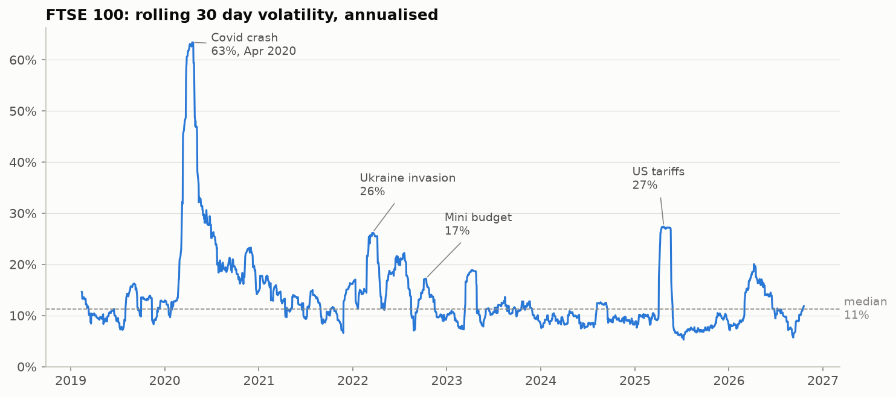
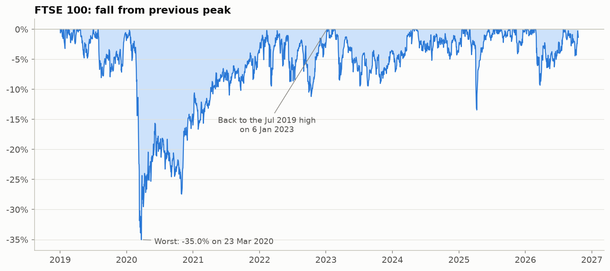
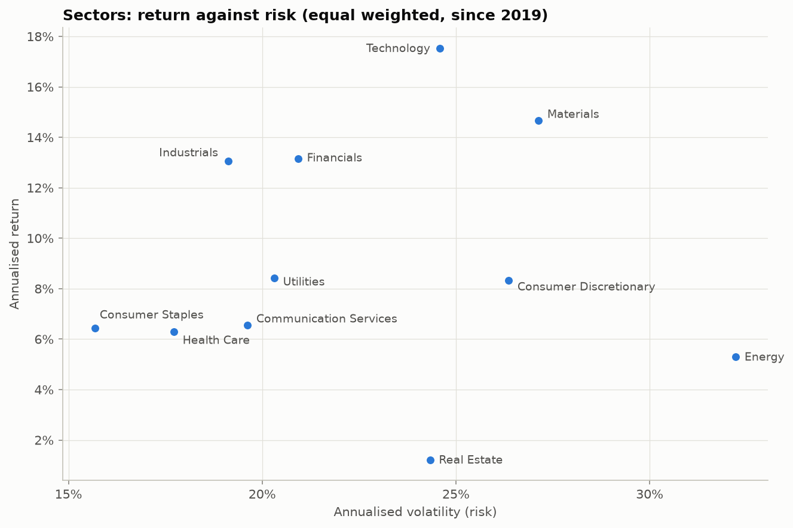

# FTSE 100 Market Analysis

An analysis of how the FTSE 100 has behaved since January 2019: its returns, volatility, drawdowns and how risk differs across sectors. Daily prices for the index and its 100 current constituents come from Yahoo Finance. The calculations are small tested Python functions in `src/`, and the notebook `notebooks/analysis.ipynb` walks through the analysis from data to findings. The period covers the March 2020 Covid crash, the 2022 invasion of Ukraine, the September 2022 mini budget and the April 2025 US tariff shock. All figures run to 19 October 2026.

## Key findings

1. **Covid was the defining shock.** The FTSE 100 fell 35% from its July 2019 high to 23 March 2020, and did not get back to that level until 6 January 2023, almost three years later. Its 30 day volatility peaked at 63%, about six times its normal level of 11%.
2. **The mini budget barely moved the FTSE 100.** Volatility peaked at about 17% in October 2022, lower than after the Ukraine invasion (26%) or the April 2025 tariff shock (27%). The index's mostly overseas earnings likely protected it from a crisis centred on gilts and sterling.
3. **Sector risk differs by a factor of two, and more risk did not mean more return.** Consumer Staples was the steadiest sector (16% volatility) and Energy the riskiest (32%). Energy and Real Estate returned little for their risk, while Industrials and Financials earned about 13% a year with middling volatility.
4. **Defensive sectors held up in the crash, and Energy is the best diversifier.** Between 19 February and 23 March 2020, Health Care fell 21% while Consumer Discretionary fell 52%. Energy has the lowest average correlation with the other sectors (0.34).

Sector figures are equal weighted and include dividends; index figures exclude dividends. See [Limitations](#limitations).







## How to run

Requires Python 3.11 or later.

```bash
python -m venv .venv
source .venv/bin/activate
pip install -r requirements.txt

python -m src.fetch   # download prices into data/raw/
pytest                # run the tests
jupyter notebook notebooks/analysis.ipynb
```

To rerun the whole notebook from the command line and regenerate the charts in `figures/`:

```bash
jupyter nbconvert --to notebook --execute --inplace notebooks/analysis.ipynb
```

### Sector explorer

A small Streamlit page lets you pick a sector and see its growth, rolling volatility, drawdown and the stocks it contains. It uses the same cleaning, metrics and end date as the notebook. Run it with:

```bash
streamlit run app.py
```

If you have already run `python -m src.fetch`, the app uses those files. If not, it downloads the same prices from Yahoo Finance on first load, which takes about half a minute.

Equal weighted sectors are not traded, so the page shows each sector as the growth of 100 invested on 2 January 2019, built from its daily returns.

The notebook fixes the analysis end date at 19 October 2026, so downloading the data again later should give the same results, apart from any corrections Yahoo makes to its past prices.

## Data

| | |
|---|---|
| Source | Yahoo Finance via the `yfinance` package |
| Index | `^FTSE` |
| Constituents | the 100 members after the 1 October 2026 index review, listed in `data/constituents.csv` |
| Dates | 2 January 2019 to 19 October 2026 (the download fetches up to the last completed trading day; the notebook stops at 19 October 2026) |
| Prices | daily closes adjusted for splits and dividends (`auto_adjust=True`) |

The constituent list was taken from the Wikipedia FTSE 100 constituents table, which cites FTSE Russell. Each company's industry label from that table (the ICB classification) was grouped into one of 11 broad sectors. Burberry and Barratt Redrow were placed in Consumer Discretionary by hand, because their ICB labels are shared with Consumer Staples companies. Investment trusts are counted as Financials.

All 100 tickers downloaded successfully, so **no tickers were dropped**. BT is listed on Yahoo as `BT-A.L`.

### Data cleaning

Two problems in the Yahoo data are fixed in `src/clean.py`. Bad daily returns are removed (set to missing) rather than replaced with a guess.

| Stock | Problem | Values removed |
|---|---|---|
| Endeavour Mining (`EDV.L`) | Before its main listing moved to London on 14 June 2021, the London price is unchanged on 64% of days, which creates false jumps of +34% and −55%. All returns up to and including 14 June 2021 are removed. | 618 |
| IAG (`IAG.L`) | The price falls 37% on 14 September 2020 around its rights issue, and Yahoo has not adjusted for it. That day's return is removed. | 1 |

## Limitations

- **Unofficial data.** yfinance scrapes Yahoo Finance and is not an official data feed. Prices may have gaps or errors. Two known errors are cleaned (see above), but others may remain. Other large one day moves were checked by eye but not against a second source.
- **IAG's price level still contains the rights issue fall.** Only that day's return is removed, so return and volatility figures are correct, but any chart of IAG's raw price would show the drop.
- **Survivorship bias.** Today's constituent list is used for every year since 2019. Companies that left the index in that time are missing and companies that joined after strong growth are included, which flatters past sector returns.
- **Equal weighted sectors.** Sector returns are the average of each stock's return, with every stock counted equally. They are not market cap weighted, so they differ from official FTSE sector indices.
- **Index excludes dividends but stocks include them.** `^FTSE` is a price index, while the constituent prices are adjusted for dividends. Sector returns are therefore total returns and are not directly comparable with the index return.
- **Shorter histories.** Six companies listed or demerged after January 2019 (Coca-Cola Europacific Partners, Airtel Africa, M&G, Haleon, Ithaca Energy, Metlen Energy & Metals), and Endeavour's data starts in June 2021 after cleaning. Sector averages use whichever stocks have prices on each day.
- **Small sectors.** Energy has 3 stocks and Technology has 2, so their figures depend heavily on individual companies.
- **Dropped tickers:** none.

## Project structure

```
ftse100-market-analysis/
├── data/
│   ├── raw/                 # downloaded prices (not committed)
│   └── constituents.csv     # ticker, company, sector
├── notebooks/
│   └── analysis.ipynb       # full analysis, start to finish
├── src/
│   ├── fetch.py             # download and save prices
│   ├── clean.py             # remove known bad returns
│   ├── metrics.py           # returns, volatility, drawdown, sector aggregation
│   └── plots.py             # reusable chart functions
├── figures/                 # charts saved by the notebook
├── app.py                   # Streamlit sector explorer
├── .streamlit/config.toml   # light theme for the app
├── tests/
│   ├── test_clean.py
│   └── test_metrics.py
├── pytest.ini
└── requirements.txt
```
